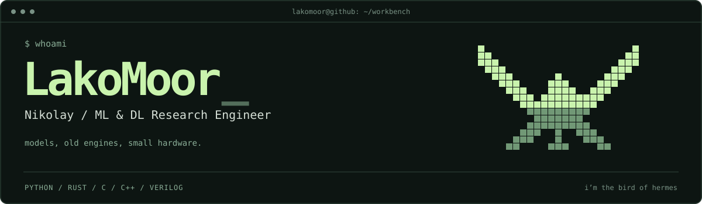

  

  
  &nbsp;
  
  &nbsp;
  

 

I work on machine learning. Here you'll also find old game engines, FPGA experiments, and a fruit fly running on a Game Boy Advance.

Python and PyTorch for ML; Rust and C/C++ for engines and native tools; Verilog and SystemVerilog for FPGA projects.

  

 

## `01` &nbsp; Selected projects

<table>
<tr>
<td width="50%" valign="top">

### [FlyWireGBA](https://github.com/LakoMoor/FlyWireGBA)

A fruit fly on the GBA: a reduced real FlyWire connectome, a neural activity view, and a Tamagotchi mode.

C · Game Boy Advance

</td>
<td width="50%" valign="top">

### [openMMD](https://github.com/LakoMoor/openMMD)

An early MikuMikuDance-compatible animation editor. Models, bones, and keyframes on desktop and in the browser.

Rust · wgpu · egui · <a href="https://lakomoor.github.io/openMMD/app/">Try in browser</a>

</td>
</tr>
<tr>
<td width="50%" valign="top">

### [OpenNokia3310](https://github.com/LakoMoor/OpenNokia3310)

Original Nokia firmware running on an FPGA. An ARM7TDMI core and the phone’s own menus; boot reliability is still a work in progress.

SystemVerilog · ARM7TDMI · Tang Nano 20K

</td>
<td width="50%" valign="top">

### [LakoTone EQ](https://github.com/LakoMoor/lakotone-eq-chrome)

A parametric equalizer for browser tabs. Drag the filters, watch the spectrum, save a preset. Audio processing stays on your device.

JavaScript · Web Audio · Chromium

</td>
</tr>
</table>

 

## `02` &nbsp; On the workbench

- **[Effective LLM Alignment](https://github.com/VikhrModels/effective_llm_alignment)** — training and alignment tools at VikhrModels: SFT, preference optimization, reward modeling, and distillation.
- **[openTPU on Tang Nano 20K](https://github.com/LakoMoor/openTPU-tangnano20k)** — an openTPU ISA implementation for a small FPGA, with language model weights streamed from an SD card.
- **[openHT2](https://github.com/LakoMoor/openHT2)** — rebuilding the runtime of *Hard Truck 2 / Дальнобойщики 2* in Rust. File formats, rendering, and vehicle physics.

<b>↳ More engines and hardware</b>

 

[openSA](https://github.com/LakoMoor/openSA) — GTA San Andreas runtime in C++ ·
[sbox-rs](https://github.com/LakoMoor/sbox-rs) — Source 2 formats and rendering in Rust ·
[pz-rust](https://github.com/LakoMoor/pz-rust) — Project Zomboid reimplementation ·
[Open Pocket GBC](https://github.com/LakoMoor/open-pocket-gbc) — Game Boy / Game Boy Color on FPGA ·
[L2D](https://github.com/LakoMoor/L2D) — an earlier C++ / SDL2 engine

 

---

<a href="https://github.com/LakoMoor?tab=repositories">Browse all repositories ↗</a>

