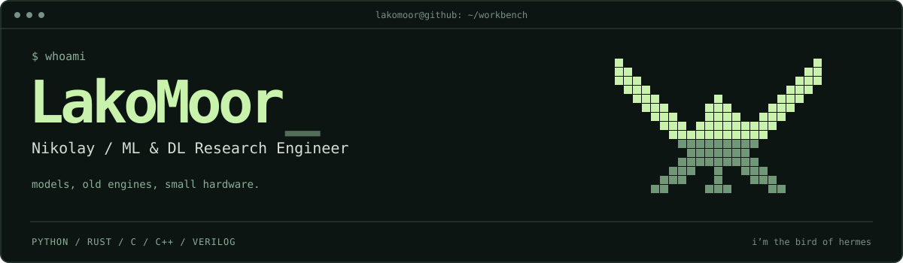

  

  
  
  

  
  

 

## `$ whoami`

**Nikolay** — ML/DL research engineer. By day I train and align language models at [VikhrModels](https://github.com/VikhrModels). By night I take things apart and rebuild them: old game engines in Rust, a Nokia on an FPGA, a fruit fly on a Game Boy Advance.

> The common thread: *take something closed, understand how it really works, and rebuild it in the open.*

 

## `01` &nbsp; Stack

| Area | Tools |
| :--- | :--- |
| **Machine learning** | Python · PyTorch · SFT / preference optimization / reward modeling / distillation |
| **Systems & engines** | Rust · wgpu · C · C++ |
| **Hardware** | Verilog · SystemVerilog · Sipeed Tang Nano 20K · open FPGA toolchain |
| **Web & tooling** | TypeScript · JavaScript · Go · GitHub Actions |

  

 

## `02` &nbsp; Selected projects

<table>
<tr>
<td width="50%" valign="top">

### [FlyWireGBA](https://github.com/LakoMoor/FlyWireGBA) &nbsp;★ 11

A fruit fly on the GBA: a reduced real FlyWire connectome, a neural activity view, and a Tamagotchi mode.

C · Game Boy Advance · <a href="https://github.com/LakoMoor/FlyWireGBA/releases">Releases</a>

</td>
<td width="50%" valign="top">

### [openMMD](https://github.com/LakoMoor/openMMD)

An early MikuMikuDance-compatible animation editor. Models, bones, and keyframes on desktop and in the browser.

Rust · wgpu · egui · <a href="https://lakomoor.github.io/openMMD/app/">Try in browser</a>

</td>
</tr>
<tr>
<td width="50%" valign="top">

### [OpenNokia3310](https://github.com/LakoMoor/OpenNokia3310)

Original Nokia firmware running on an FPGA. An ARM7TDMI core and the phone's own menus. Work in progress.

SystemVerilog · ARM7TDMI · Tang Nano 20K

</td>
<td width="50%" valign="top">

### [LakoTone EQ](https://github.com/LakoMoor/lakotone-eq-chrome)

A parametric equalizer for browser tabs. Drag the filters, watch the spectrum, save a preset. Audio processing stays on your device.

JavaScript · Web Audio · Chromium

</td>
</tr>
</table>

 

## `03` &nbsp; Everything else, by theme

### 🧠 ML & AI agents

| Project | What it is |
| :--- | :--- |
| [Effective LLM Alignment](https://github.com/VikhrModels/effective_llm_alignment) | Training and alignment toolkit at VikhrModels: SFT, preference optimization, reward modeling, distillation. |
| [portcode](https://github.com/LakoMoor/portcode) `★ 8` | Port anything to Rust, with proof. Terminal agent for reverse engineering and Rust ports on local / self-hosted LLMs. |
| [rustport-skill](https://github.com/LakoMoor/rustport-skill) | Claude Code skill for porting games and apps to Rust (+ wgpu). |
| [Axiom](https://github.com/LakoMoor/Axiom) | See how software works, with local AI models. Pure Rust. |
| [termvm](https://github.com/LakoMoor/termvm) | A separate desktop for AI agents: a QEMU Linux/Windows VM controlled from a terminal, with an MCP server. |
| [mlchain](https://github.com/LakoMoor/mlchain) | A blockchain where mining *is* training a neural network (Proof of Training). |

### 🎮 Engines & reimplementations

| Project | What it is |
| :--- | :--- |
| [openHT2](https://github.com/LakoMoor/openHT2) `★ 4` | Free engine reimplementation of *Hard Truck 2 / Дальнобойщики 2* in Rust + wgpu. |
| [openSA](https://github.com/LakoMoor/openSA) | GTA San Andreas runtime in C++ (librw). No game files included. |
| [sbox-rs](https://github.com/LakoMoor/sbox-rs) | s&box in Rust: scene runtime, Source 2 format loaders, renderer. |
| [pz-rust](https://github.com/LakoMoor/pz-rust) | Project Zomboid (Build 42) reimplemented from scratch in Rust. |
| [metrostroi-rs](https://github.com/LakoMoor/metrostroi-rs) | Metro simulator in Rust + wgpu running Metrostroi content and Lua logic. |
| [aeris](https://github.com/LakoMoor/aeris) | An operating system written in Rust. |

### 🔌 FPGA & hardware

| Project | What it is |
| :--- | :--- |
| [openTPU · Tang Nano 20K](https://github.com/LakoMoor/openTPU-tangnano20k) `★ 2` | An AI accelerator ISA on a $25 FPGA. Language models streamed from an SD card, bit-exact with the simulator. |
| [Open Pocket GBC](https://github.com/LakoMoor/open-pocket-gbc) `★ 4` | Game Boy / Game Boy Color on the Tang Nano 20K: HDMI, Pocket-style menu, ST7735 LCD. Open toolchain only. |
| [OpenNokia3310](https://github.com/LakoMoor/OpenNokia3310) | Nokia 3310 firmware on FPGA: ARM7TDMI, HDMI, ST7735S, DualShock 2. |

### 📱 Mobile

[opencode-android](https://github.com/LakoMoor/opencode-android) — OpenCode on Android, self-contained APK ·
[pi-android](https://github.com/LakoMoor/pi-android) — Pi coding agent with a local Ubuntu (PRoot) ·
[ios-beryllium](https://github.com/LakoMoor/ios-beryllium) — iOS 16 on Poco F1

 

## `04` &nbsp; Feeding the snake

<picture>
  <source media="(prefers-color-scheme: dark)" srcset="assets/snake-dark.svg" />
  <source media="(prefers-color-scheme: light)" srcset="assets/snake.svg" />
  
</picture>

My contribution graph, one square at a time. [Updated daily](https://github.com/LakoMoor/LakoMoor/actions/workflows/snake.yml) · [Made with snk](https://github.com/Platane/snk)

 

## `05` &nbsp; Say hi

Open to talking about LLM training and alignment, reverse engineering, FPGA, and Rust ports. Best way: the [website](https://lakomoor.com) or an issue in any repo above.

---

<a href="https://github.com/LakoMoor?tab=repositories">Browse all repositories ↗</a>

